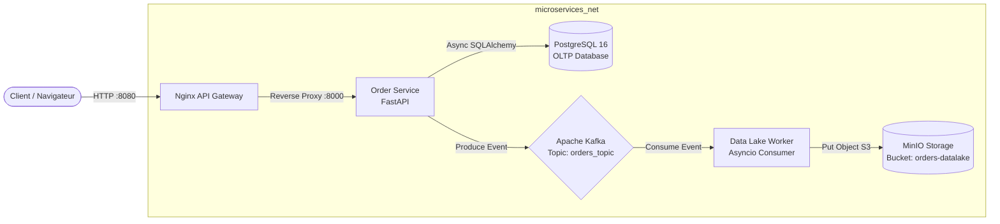

# Event-Driven E-Commerce Microservices & Data Lake Architecture


Architecture de microservices orientée événements (**Event-Driven Architecture**) séparant les traitements transactionnels (**OLTP**) de l'archivage analytique (**OLAP / Data Lake**). Le système est entièrement conteneurisé et orchestré via Docker Compose derrière une **API Gateway Nginx**.

---

## Architecture du Système

Le flux de données découple la prise de commande synchrone (REST API) du traitement analytique asynchrone grâce à **Apache Kafka (mode KRaft sans ZooKeeper)**.



### Composants Principaux

| Service | Rôle & Responsabilité | Stack Technique | Port Exposé |
| :--- | :--- | :--- | :--- |
| **`gateway`** | Point d'entrée unique (Reverse Proxy), routage et isolation réseau des services internes. | Nginx Alpine | `8080` |
| **`order_service`** | Service transactionnel (OLTP) : validation des schémas, persistance SQL asynchrone et publication d'événements. | FastAPI, SQLAlchemy 2.0 (Async), Pydantic, AIOKafka | Interne (`8000`) |
| **`postgres`** | Base de données relationnelle stockant l'état courant des commandes. | PostgreSQL 16 | `5432` |
| **`kafka`** | Bus d'événements distribué assurant le découplage et la résilience des messages. | Apache Kafka (KRaft) | `9092` |
| **`datalake_worker`** | Service analytique (OLAP) en tâche de fond : consomme les événements Kafka et les archive en JSON. | Python Asyncio, AIOKafka, MinIO SDK | Tâche de fond |
| **`minio`** | Stockage objet compatible AWS S3 hébergeant le Data Lake partitionné. | MinIO (Chainguard) | `9000` (API) / `9001` (UI) |

---

## Structure du Projet

```text
microservices-fullstack-lab/
├── gateway/
│   └── nginx.conf                  # Configuration du Reverse Proxy Nginx
├── services/
│   ├── order_service/              # Microservice Transactionnel (OLTP)
│   │   ├── Dockerfile
│   │   ├── requirements.txt
│   │   ├── database.py             # Configuration SQLAlchemy Async & Session
│   │   ├── models.py               # Modèle relationnel ORM (Table 'orders')
│   │   ├── schemas.py              # Validation des données entrantes/sortantes (Pydantic)
│   │   ├── kafka_producer.py       # Producteur asynchrone d'événements Kafka
│   │   └── main.py                 # Endpoints REST FastAPI & cycle de vie (Lifespan)
│   └── datalake_worker/            # Microservice Analytique (OLAP)
│       ├── Dockerfile
│       ├── requirements.txt
│       └── worker.py               # Consommateur Kafka & archivage S3 partitionné
├── .gitignore
├── docker-compose.yml              # Orchestration complète des 6 conteneurs & Healthchecks
└── README.md
```

---

## Démarrage Rapide (Quickstart)

### Prérequis
* **Docker** et **Docker Compose** installés et actifs sur la machine.

### 1. Cloner le dépôt et lancer l'architecture
Une seule commande compile les images Python, crée le réseau isolé, vérifie la santé (`healthcheck`) de PostgreSQL et Kafka, puis démarre l'ensemble des services :

```bash
git clone [https://github.com/bruyeron/microservices-fullstack.git](https://github.com/bruyeron/microservices-fullstack.git)
cd microservices-fullstack
docker compose up -d --build
```

### 2. Vérifier l'état des conteneurs
```bash
docker compose ps
```
Les 6 services (`compose_gateway`, `compose_order_service`, `compose_datalake_worker`, `compose_postgres`, `compose_kafka`, `compose_minio`) doivent afficher le statut `Up`.

---

## Tester le Flux de Bout en Bout (End-to-End)

### 1. Vérifier la santé de l'API Gateway
```bash
curl http://localhost:8080/gateway-health
```
Réponse attendue : `{"status": "API Gateway is healthy"}`

### 2. Créer une commande via Swagger UI ou cURL
Accédez à l'interface Swagger exposée à travers la Gateway sur **[http://localhost:8080/docs](http://localhost:8080/docs)** ou exécutez une requête `POST` :

```bash
curl -X POST "http://localhost:8080/api/orders" \
     -H "Content-Type: application/json" \
     -d '{
           "customer_id": "CUST-2026-01",
           "item": "Clavier Mécanique RGB",
           "amount": 129.99
         }'
```

### 3. Observer le traitement asynchrone dans les logs
```bash
docker compose logs -f datalake_worker
```
Le worker intercepte l'événement `OrderCreated` en temps réel et l'archive dans MinIO avec un partitionnement temporel standardisé (**Hive-style partitioning**) :
`orders-datalake/raw/orders/year=YYYY/month=MM/day=DD/order_<id>_<timestamp>.json`

### 4. Explorer le Data Lake dans MinIO Console
1. Ouvrez **[http://localhost:9001](http://localhost:9001)** dans votre navigateur.
2. Connectez-vous avec les identifiants par défaut :
   * **Username :** `minioadmin`
   * **Password :** `minioadmin`
3. Rendez-vous dans **Object Browser** > **`orders-datalake`** pour inspecter et télécharger les fichiers JSON générés.

---

## Choix d'Ingénierie & Bonnes Pratiques

* **Découplage Temporel & Résilience :** Si le Data Lake (`minio` ou `datalake_worker`) est temporairement indisponible ou en maintenance, l'API `order_service` continue d'enregistrer les commandes clients sans aucune latence ni perte de données. Kafka conserve les événements jusqu'au retour en ligne du worker (`auto_offset_reset="earliest"`).
* **Traitement 100 % Non-Bloquant :** Utilisation combinée de `asyncpg`, `AIOKafka` et `asyncio.to_thread()` dans le worker pour éviter tout blocage de la boucle d'événements Python lors des opérations d'écriture réseau S3.
* **Partitionnement Analytique (Hive Partitioning) :** Structuration des objets S3 sous la forme `raw/orders/year=YYYY/month=MM/day=DD/` afin d'optimiser les requêtes analytiques futures (Spark, DuckDB, Trino, AWS Athena) par filtrage de partitions.
* **Orchestration Déterministe :** Utilisation de `healthcheck` et `condition: service_healthy` dans `docker-compose.yml` pour garantir que les microservices Python ne démarrent qu'une fois PostgreSQL et Kafka totalement initialisés.